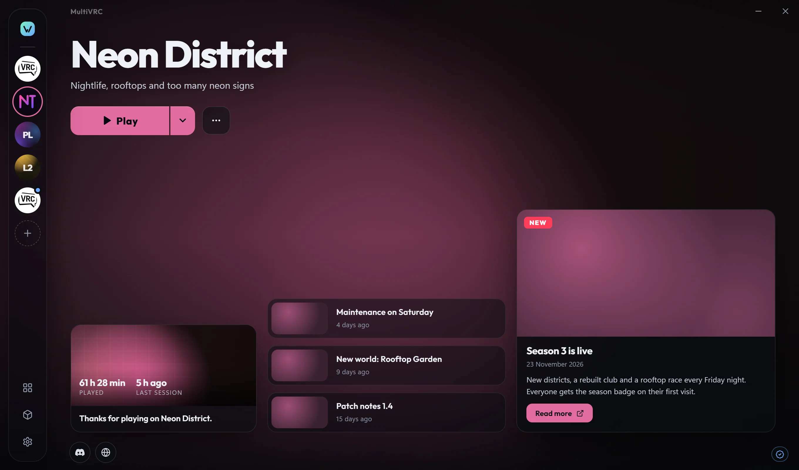

<div align="center">


# MultiVRC

**Simplify your VRChat setup.**<br>
Official VRChat, betas, old builds and private servers. Installed together, never in each other's way.

[](https://github.com/ehkogh/MultiVRC/releases/latest)
[](https://github.com/ehkogh/MultiVRC/actions/workflows/ci.yml)
[](LICENSE)
[](#building)

[**Download**](https://github.com/ehkogh/MultiVRC/releases/latest) · [Website](https://multivrc.ehko.dev) · [Verified servers](https://multivrc.ehko.dev/#servers) · [Making a template](docs/making-templates.md)

<br>



</div>

<br>

MultiVRC is a launcher for VRChat in the spirit of MultiMC. Keep the official release, open betas,
old versions and private servers installed together without them touching each other's files,
settings or logins. Built with C# and [Photino.Blazor](https://github.com/tryphotino/photino.Blazor).

## Contents

- [Features](#features)
- [Easy Anti-Cheat](#easy-anti-cheat)
- [Trust badges](#trust-badges)
- [Templates](#templates)
- [Updates](#updates)
- [Building](#building)
- [Releasing](#releasing)
- [The site](#the-site)
- [Licence](#licence)

## Features

| | |
| --- | --- |
| **Builds** | Any version of the game, downloaded from Steam by branch or manifest, or imported from a folder. Updates only fetch what changed. |
| **Instances** | One setup of a build. Instances hardlink their build's files, so ten of them take the space of one. |
| **Isolation** | Every instance keeps its own data, settings and saved login. They swap in at launch and back when the game closes, even after a crash. |
| **Templates** | A server's ready-made setup (build, loader, plugins, config, arguments) plus its look: art, news and links. Installed from one URL. |

<details>
<summary><b>How it works</b></summary>

<br>

- **Builds.** The launcher signs in to Steam itself (password with Steam Guard, or the Steam app's
  QR scanner) through [SteamKit2](https://github.com/SteamRE/SteamKit) and downloads VRChat's
  depot from Steam's servers. An update reuses every unchanged file of the previous build. The
  sign-in is kept as Steam's refresh token, encrypted for your Windows account (DPAPI); your
  password is never kept.
- **Instances.** Anything an instance changes is its own copy; the build never changes.
- **Isolation.** While an instance runs, VRChat's data folder (`AppData\LocalLow\VRChat\VRChat`)
  and its settings and saved login (`HKCU\Software\VRChat\VRChat`) are the instance's own. The
  launcher swaps them in before the game starts and puts yours back when it closes.
- **Templates.** Servers host their template as a JSON file; players install it from its URL.

</details>

## Easy Anti-Cheat

Using the launcher must never be why someone is banned.

- **Official instances are never modified.** No files are added or changed and nothing is loaded
  into the game. They start through `start_protected_game.exe`, as Steam starts them.
- **Isolation happens outside the game**, on disk and in the registry, before launch and after
  exit. The game's process is never touched.
- **One instance runs at a time**, so a modded client never runs beside an official one.
- **Modded instances never see your official login.** The saved login is part of what is swapped.

Templates that install files are only allowed for modded instances, and the launcher shows
everything a template downloads (and whether it has a checksum) before you use it.

## Trust badges

The corner of a server's page says how far it can be trusted (icon only; hover for the text).

| Badge | Meaning |
| --- | --- |
| 🟢 **Official** | VRChat as Steam ships it, protected by Easy Anti-Cheat. |
| 🔵 **Verified** | A community server that people the project trusts have checked. Still a modded client, not anti-cheat protected. |
| ⚪ **Unverified** | A community server nobody has checked. Its template can install files that run with the game. |

Verification is kept with this project, never with a server: a template cannot vouch for itself.
The list is served by the project's site at
[`multivrc.ehko.dev/api/verified-servers`](https://multivrc.ehko.dev/api/verified-servers), and a
server is verified only if its template was installed from exactly a listed URL. Templates shipped
inside the launcher count as verified.

**Run a server?** Apply on the [website](https://multivrc.ehko.dev/#apply). Pin your downloads with
`sha256` first.

## Templates

New to templates? Start with the step-by-step guide: **[Making a template](docs/making-templates.md)**.

```json
{
  "id": "my-server",
  "name": "My Server",
  "server": "My Server",
  "kind": "Modded",
  "version": "1.4.0",
  "build": { "version": "2026.4.1p1-1937", "manifestId": "1234567890123456789" },
  "downloads": [
    { "url": "https://example.com/loader.zip", "path": "", "extract": true, "sha256": "…" }
  ],
  "files": [ { "path": "BepInEx/config/my.cfg", "content": "server=https://example.com" } ],
  "arguments": ["--no-vr"],
  "branding": {
    "tagline": "One line under the name",
    "iconUrl": "https://example.com/icon.png",
    "backgroundUrl": "https://example.com/art.jpg",
    "news": { "type": "json", "url": "https://example.com/api/1/news" },
    "links": [ { "label": "Discord", "url": "https://discord.gg/…", "kind": "discord" } ]
  }
}
```

| Field | |
| --- | --- |
| `version` | Bump it whenever the template changes. Instances installed from a URL are brought up to date when the launcher sees a new version (it re-reads the URL at start and every half hour). |
| `build.manifestId` | Pins an exact build. `build.branch` instead follows a Steam branch's newest build; only use it if your mods keep up with VRChat's updates. |
| `branding.iconUrl` | The server's square icon (at least 128×128), shown on the rail, in the library and on its page. `iconBackground` (a CSS colour) puts a transparent logo on its own colour. |
| `branding.news` | `rss`, or `json`: a list of `{ title, summary, imageUrl, url, publishedAt }`. |
| `copies` | `{ "from", "to", "junction" }` inside the game folder, for loaders that need the game's exe under another name. `junction: true` links a folder, such as the renamed exe's `_Data`. |

Everything a template adds is the instance's own file. The build's files, shared by every instance
including official ones, are never written to.

<details>
<summary><b>Mod loaders: BepInEx and MelonLoader</b></summary>

<br>

The launcher doesn't know about loaders: a template says what to unpack, write and start.

**BepInEx** (6, IL2CPP). Its zip unpacks into the game folder (`winhttp.dll`,
`doorstop_config.ini`, `BepInEx/`, `dotnet/`). Plugins go in `BepInEx/plugins`, configs in
`BepInEx/config`.

```json
"downloads": [
  { "url": "https://example.com/BepInEx-Unity.IL2CPP-win-x64.zip", "path": "", "extract": true, "sha256": "…" },
  { "url": "https://example.com/MyServer.Plugin.dll", "path": "BepInEx/plugins/MyServer.Plugin.dll", "sha256": "…" }
],
"files": [ { "path": "BepInEx/config/MyServer.cfg", "content": "[Server]\nApiUrl = https://api.example.com/api/1/\n" } ],
"executable": "VRChat.exe"
```

**MelonLoader.** Its zip unpacks into the game folder (`version.dll`, `MelonLoader/`). Mods go in
`Mods/`, plugins in `Plugins/`, configs in `UserData/`. VRChat's own exe doesn't load it, so the
template starts a renamed copy with its `_Data` folder linked beside it.

```json
"downloads": [
  { "url": "https://example.com/MelonLoader.x64.zip", "path": "", "extract": true, "sha256": "…" },
  { "url": "https://example.com/MyServer.Mod.dll", "path": "Mods/MyServer.Mod.dll", "sha256": "…" }
],
"files": [ { "path": "UserData/MyServer.cfg", "content": "ApiUrl = https://api.example.com/api/1/\n" } ],
"copies": [
  { "from": "VRChat.exe", "to": "VRChatML.exe" },
  { "from": "VRChat_Data", "to": "VRChatML_Data", "junction": true }
],
"executable": "VRChatML.exe"
```

Both generate their interop assemblies on an instance's first start, which takes a few minutes.

</details>

## Updates

**The game.** Official instances follow a Steam branch (`public`, `open-beta`, …). The launcher
reads VRChat's branches with an anonymous Steam login, so no account is needed to see a new build,
and downloads new builds with the kept sign-in. Instances update by themselves unless that is
turned off for them (or in Settings). Nothing updates while it is running.

**The launcher.** MultiVRC updates itself from this repository's releases. It checks when it starts
and every few hours. With automatic updates on (Settings → MultiVRC), a new version downloads in the
background, is checked against the release's `.sha256`, and installs the next time MultiVRC starts;
**Restart to update** installs it at once. Pre-releases are only offered if you turn them on.
Development builds never update themselves.

## Building

Needs the [.NET 10 SDK](https://dotnet.microsoft.com/download) on Windows.

```powershell
dotnet build
dotnet test
dotnet run --project src/MultiVRC.App
```

| Environment variable | |
| --- | --- |
| `MULTIVRC_DATA_DIR` | Use another data folder instead of `%LOCALAPPDATA%\MultiVRC`. |
| `MULTIVRC_DEVTOOLS_PORT` | Open the UI to Chrome DevTools or Playwright over CDP, e.g. `9333`. |
| `MULTIVRC_VERIFIED_URL` | Read the verified list from another address, such as a local `wrangler dev`. |

## Releasing

Push a tag. `v0.2.0` publishes a release and `v0.3.0-beta.1` publishes a pre-release
([`release.yml`](.github/workflows/release.yml)). The workflow tests, builds a self-contained
`MultiVRC-win-x64.zip` with the tag as its version, builds the installer, and attaches them with the
zip's `.sha256`. The zip and its `.sha256` are what launchers update from.

```powershell
git tag v0.2.0
git push origin v0.2.0
```

To build the installer locally (needs Inno Setup 6: `winget install JRSoftware.InnoSetup`):

```powershell
powershell -ExecutionPolicy Bypass -File installer\build.ps1                  # version from the project
powershell -ExecutionPolicy Bypass -File installer\build.ps1 -Version 0.2.0
```

This writes `installer/out/MultiVRC-Setup-<version>.exe` and the update zip. The setup installs for
the current user only, with no admin prompt, into `%LOCALAPPDATA%\Programs\MultiVRC`, where
self-updates can replace the program's files. It adds Start menu (and optionally desktop)
shortcuts and an Apps & features entry. Uninstalling asks before deleting the data in
`%LOCALAPPDATA%\MultiVRC` (instances, downloaded builds, settings), and defaults to keeping it.

## The site

[`worker/`](worker) is a Cloudflare Worker that is both MultiVRC's homepage and its management
panel, live at [multivrc.ehko.dev](https://multivrc.ehko.dev).

| Route | |
| --- | --- |
| `/` | The homepage: the latest release's download, the verified servers (art, icon and links read from each template) and the form server owners use to ask for verification. |
| `/api/verified-servers` | The list launchers read (also at `/verified-servers.json`). |
| `/admin` | The management panel. Add, edit, reorder and remove verified servers, review requests (each template is checked automatically: HTTPS, valid JSON, every download pinned by `sha256`, build pinned to a manifest) and see every change in the activity log. |

Data is kept in Workers KV. Pushes to `main` that touch `worker/` deploy it
([`deploy-site.yml`](.github/workflows/deploy-site.yml)). To run it locally, put `ADMIN_PASSWORD`
in `worker/.dev.vars`, then:

```powershell
cd worker
npm install
npm run dev
```

<details>
<summary><b>Deploying your own copy</b></summary>

<br>

```powershell
cd worker
npx wrangler kv namespace create multivrc-data   # put the id in wrangler.toml
npx wrangler secret put ADMIN_PASSWORD
npx wrangler secret put SESSION_SECRET           # any long random string
npx wrangler deploy
```

`wrangler.toml` claims `multivrc.ehko.dev` as a custom domain. If you use another one, change
`DefaultListUrl` in `src/MultiVRC.Core/Verification.cs` to match. Setting `TURNSTILE_SITE_KEY` (in
`wrangler.toml`) and the `TURNSTILE_SECRET` secret adds a Cloudflare Turnstile challenge to the
request form.

</details>

## Not done yet

- Running several modded instances at once. This needs per-process isolation; official instances
  will stay one at a time.

## Licence

[MIT](LICENSE). Icons are from [Lucide](https://lucide.dev) (ISC) and brand marks from
[Simple Icons](https://simpleicons.org) (CC0). The Outfit font is under the SIL Open Font Licence.

VRChat is a trademark of VRChat Inc. This project is not affiliated with it.
